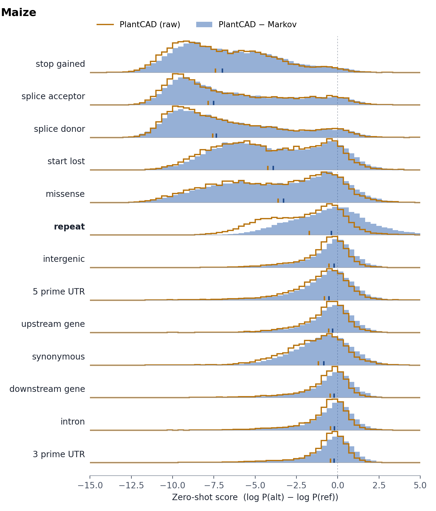

# Zero-shot Scoring of SNPs and Genomic Regions

[← Back to main README](../README.md)

The `zero_shot_score.py` script scores single-nucleotide polymorphisms (SNPs) or entire genomic regions using PlantCAD's log-likelihood ratios. It supports two primary modes:

1. **Variant Scoring (VCF Input):** Scores specific genetic variants provided in a VCF file.
2. **Genome-Wide Region Scoring (BED Input):** Calculates log-likelihood ratios for all positions within specified genomic regions (BED file).

> **⭐ Strongly recommended:** raw zero-shot scores over-estimate conservation in transposable elements and other repeats. Use the **[Markov background correction →](#markov-background-correction)**

## Choosing a model and context size

| Scenario                     | Recommended Model     | `-contextSize` | GPU Memory* | Notes                                                                                   |
| :--------------------------- | :-------------------- | :--------------- | :---------- | :-------------------------------------------------------------------------------------- |
| Limited GPU                  | `PlantCaduceus_l32` | `512` (fixed)  | ~2–3 GB    | Works well for both coding and noncoding variants. Fast and lightweight.                |
| Higher noncoding sensitivity | `PlantCAD2-Medium`  | `≥ 2048`      | ~10–34 GB  | Longer context improves sensitivity for noncoding regions (promoters, enhancers, etc.). |
| Best accuracy                | `PlantCAD2-Large`   | `≥ 2048`      | ~15–51 GB  | Highest accuracy overall. Use `4096` or `8192` if GPU memory allows.                |

> **🔒 Context size rules:**
>
> - **PlantCaduceus (v1):** context is always fixed at **512**. The script will override any other value.
> - **PlantCAD2:** minimum context is **2048**. If you specify a smaller value, the script will automatically raise it to 2048 with a warning. You can set it higher (up to 8192) for better accuracy.
>
> **⏱️ Note on inference time:** Inference time scales approximately **linearly** with `-contextSize`. For example, doubling the context window roughly doubles the runtime. Choose a context size that balances your accuracy needs with your compute budget. See the [inference speed table](model-recommendations.md#inference-speed) for detailed benchmarks.

## Parameter reference

| Parameter             | Applies to | Default       | Description                                                                                                                                                                                          |
| :-------------------- | :--------- | :------------ | :--------------------------------------------------------------------------------------------------------------------------------------------------------------------------------------------------- |
| `-input-vcf`        | VCF mode   | —            | Path to input VCF file (mutually exclusive with `-input-bed`)                                                                                                                                      |
| `-input-bed`        | BED mode   | —            | Path to BED file specifying genomic regions                                                                                                                                                          |
| `-input-fasta`      | Both       | —            | Path to reference genome FASTA (required)                                                                                                                                                            |
| `-output`           | Both       | —            | Path to output file                                                                                                                                                                                  |
| `-model`            | Both       | —            | HuggingFace model name or local path                                                                                                                                                                 |
| `-device`           | Both       | `cuda:0`    | Compute device                                                                                                                                                                                       |
| `-batchSize`        | Both       | `128`       | Batch size for inference                                                                                                                                                                             |
| `-contextSize`      | Both       | `2048`      | Context window size in bp. **Must ≤ model's max input length.** Auto-enforced: PlantCaduceus → 512; PlantCAD2 → min 2048.                                                                   |
| `-step-size`        | BED only   | `1`         | Positions scored per window. Larger = faster but less precise ([details](step_size_genome_wide_llr.md)).                                                                                              |
| `-use-masking`      | BED only   | `False`     | Mask the center position(s) during inference. Recommended only with `-step-size 1`.                                                                                                                |
| `-aggregation`      | BED only   | `average`   | How to aggregate alt-allele scores: `max`, `average`, or `all`.                                                                                                                                |
| `-output-raw-prob`  | BED only   | `False`     | Include raw nucleotide probabilities in output.                                                                                                                                                      |
| `-markov-table`     | Both       | —            | **Recommended.** k-mer count table from `src/markov_background.py`; adds Markov-corrected scores that remove inflated conservation in repeats/TEs ([details](#markov-background-correction)). |
| `-markov-smoothing` | Both       | `add`       | Markov smoothing: `add` (pseudocount) or `backoff`.                                                                                                                                              |
| `-markov-alpha`     | Both       | `2` / `8` | Pseudocount (`add`) or backoff strength (`backoff`).                                                                                                                                             |
| `-markov-direction` | Both       | `both`      | Markov context: `both` (upstream + downstream, strand-symmetric) or `left` (upstream 13 bp only).                                                                                                |

## Examples

### Setup: Download reference genome

```bash
wget https://download.maizegdb.org/Zm-B73-REFERENCE-NAM-5.0/Zm-B73-REFERENCE-NAM-5.0.fa.gz
gunzip Zm-B73-REFERENCE-NAM-5.0.fa.gz
```

### VCF Input Mode

Estimate impact of specific variants from a VCF file. Only the first 8 columns of the VCF file (CHROM, POS, ID, REF, ALT, QUAL, FILTER, INFO) are strictly required.

```bash
# Using PlantCAD (v1), which requires a fixed 512bp context
python src/zero_shot_score.py \
    -input-vcf examples/example_maize_snp.vcf \
    -input-fasta Zm-B73-REFERENCE-NAM-5.0.fa \
    -output scored_variants.vcf \
    -model 'kuleshov-group/PlantCaduceus_l32' \
    -contextSize 512 \
    -device 'cuda:0'
    # PlantCaduceus (PlantCAD v1) forces contextSize=512 regardless of the default (2048)

# Using PlantCAD2 with a larger context window
python src/zero_shot_score.py \
    -input-vcf examples/example_maize_snp.vcf \
    -input-fasta Zm-B73-REFERENCE-NAM-5.0.fa \
    -output scored_variants_cad2.vcf \
    -model 'kuleshov-group/PlantCAD2-Large-l48-d1536' \
    -contextSize 2048 \
    -device 'cuda:0'
    # PlantCAD2 supports up to 8192bp; larger context can improve accuracy
```

**Expected output:**

- A new VCF file with PlantCAD scores added to the INFO field.
- Scores represent log-likelihood ratios between reference and alternative alleles. Low negative scores indicate potentially more deleterious mutations.

### BED Input Mode

Calculate log-likelihood ratios for all positions within specified genomic regions.

```bash
# Create example BED file
echo -e "chr1\t1000\t1010\nchr1\t2000\t2015" > examples/example_regions.bed

# Using PlantCAD (v1) — default 512bp context
python src/zero_shot_score.py \
    -input-bed examples/example_regions.bed \
    -input-fasta Zm-B73-REFERENCE-NAM-5.0.fa \
    -output genome_wide_scores.tsv \
    -model 'kuleshov-group/PlantCaduceus_l32' \
    -contextSize 512 \
    -device 'cuda:0' \
    -step-size 1 \
    -aggregation average \
    -use-masking \
    -output-raw-prob
    # Explicitly set -contextSize 512 (max for PlantCaduceus v1; script enforces this)

# Using PlantCAD2 with larger context
python src/zero_shot_score.py \
    -input-bed examples/example_regions.bed \
    -input-fasta Zm-B73-REFERENCE-NAM-5.0.fa \
    -output genome_wide_scores_cad2.tsv \
    -model 'kuleshov-group/PlantCAD2-Large-l48-d1536' \
    -contextSize 4096 \
    -device 'cuda:0' \
    -step-size 8 \
    -aggregation average
    # PlantCAD2 supports up to 8192bp context; step-size 8 gives ~8x speedup
```

**Expected output:**

- A tab-separated file containing scores for each position.
- Output includes chromosome, start, end, reference allele, aggregated score, and optionally raw probabilities for all four nucleotides.

When analyzing the entire genome or large genomic regions, the `-step-size` parameter is very important for speeding up the analysis. For a detailed guide on this trade-off between speed and accuracy, see **[Step Size Guide](step_size_genome_wide_llr.md)**.

## Markov background correction

Raw zero-shot scores **over-estimate conservation in transposable elements and other repeats**, because repeated k-mers are easy to predict from local sequence alone. Subtracting the log-likelihood ratio of a genome-wide 13-mer Markov model removes this bias. Mutations in repeats are corrected toward neutral, while functional classes (stop-gained, splice sites, missense) stay almost unchanged. **We strongly recommend using the corrected score for all zero-shot analyses.**

<p align="center">
  
</p>

### Step 1: Build the k-mer table (once per reference genome)

```bash
python src/markov_background.py \
    -input-fasta Zm-B73-REFERENCE-NAM-5.0.fa \
    -output Zm-B73-NAM5_k13.npz \
    -k 13 \
    -threads 16
```

- For the 2.2 Gb maize genome this takes ~1 min with 16 threads. Each worker needs up to ~5–7 GB RAM while counting a large chromosome, so lower `-threads` on smaller machines. Output is ~1.1 GB.
- Use the **same reference genome** as `-input-fasta` in scoring. The table is genome-specific but model-agnostic: it works with both PlantCaduceus and PlantCAD2.
- The FASTA must be uncompressed. Soft-masked (lowercase) bases are counted like uppercase; `N` breaks k-mers.
- `-exclude chrM chrC` skips organelle genomes; `-single-strand` counts the + strand only (not recommended).

### Step 2: Score with the correction

Add `-markov-table` to any command above.

```bash
# VCF mode
python src/zero_shot_score.py \
    -input-vcf examples/example_maize_snp.vcf \
    -input-fasta Zm-B73-REFERENCE-NAM-5.0.fa \
    -output scored_variants.vcf \
    -model 'kuleshov-group/PlantCaduceus_l32' \
    -contextSize 512 \
    -device 'cuda:0' \
    -markov-table Zm-B73-NAM5_k13.npz

# BED mode
python src/zero_shot_score.py \
    -input-bed examples/example_regions.bed \
    -input-fasta Zm-B73-REFERENCE-NAM-5.0.fa \
    -output genome_wide_scores.tsv \
    -model 'kuleshov-group/PlantCaduceus_l32' \
    -contextSize 512 \
    -device 'cuda:0' \
    -markov-table Zm-B73-NAM5_k13.npz
```

**VCF output.** Three INFO fields, one value per ALT allele:

| INFO field                       | Meaning                                                                     |
| :------------------------------- | :-------------------------------------------------------------------------- |
| `plantCAD_zero_shot`           | Raw PlantCAD score (unchanged)                                              |
| `plantCAD_markov_llr`          | Markov background LLR                                                       |
| `plantCAD_zero_shot_corrected` | `plantCAD_zero_shot − plantCAD_markov_llr` (**recommended score**) |

**BED output.** Two columns are appended after the existing ones. `corrected_score` (or `corrected_scores` with `-aggregation all`) is aggregated the same way as `score`. `markov_llrs` gives one value per alt allele, in `alt_alleles` order. Existing columns are unchanged.

Options (`-markov-smoothing`, `-markov-alpha`, `-markov-direction`) are listed in the [parameter reference](#parameter-reference); the defaults are recommended.

### Already have raw scores? Correct them without re-running the model

The correction only needs the reference genome and the k-mer table, not the GPU or the PlantCAD model. `src/markov_correct.py` adds it to existing `zero_shot_score.py` outputs in seconds and gives the same values as `-markov-table`:

```bash
# VCF (needs INFO/plantCAD_zero_shot)
python src/markov_correct.py \
    -input scored_variants.vcf \
    -input-fasta Zm-B73-REFERENCE-NAM-5.0.fa \
    -markov-table Zm-B73-NAM5_k13.npz \
    -output scored_variants.corrected.vcf

# BED-mode TSV
python src/markov_correct.py \
    -input genome_wide_scores.tsv \
    -input-fasta Zm-B73-REFERENCE-NAM-5.0.fa \
    -markov-table Zm-B73-NAM5_k13.npz \
    -output genome_wide_scores.corrected.tsv
```

- The input format (VCF or BED-mode TSV) is detected automatically, and the output fields and columns are the same as above.
- Chromosome names with or without a `chr` prefix are matched to the FASTA.
- BED-mode files from `-aggregation all` or `average` (the default) are corrected exactly. A `max` file can only be corrected if it was written with `-output-raw-prob`; pass `-aggregation max`.

### How it works

```
markov_llr      = log P_markov(alt | context) − log P_markov(ref | context)
corrected_score = plantcad_llr − markov_llr
```

- `P_markov(base | context)` comes from genome-wide 14-mer counts (13 bp context + the base), counted on both strands and smoothed with a pseudocount of 2.
- With the default `-markov-direction both`, the + strand model (13 bp upstream) and the − strand model (reverse complement of the 13 bp downstream) are averaged, so the background is bidirectional like PlantCAD.
- Contexts that contain `N` or run off a chromosome end back off to the longest valid suffix.
- Inside repeats the k-mer model is confident, so `markov_llr` is strongly negative and the correction is large. In functional sequence a 13-mer predicts the base poorly, so `markov_llr ≈ 0` and the score barely changes.

### Benchmark (maize chr8)

287,547 simulated SNVs on B73 chr8 (20k per VEP consequence), scored with `PlantCaduceus_l32` at 512 bp. Lower scores mean more deleterious. "Functional" = stop-gained + splice donor/acceptor; `repeat` = TE-overlapping intergenic/intron/up-/downstream variants.

| Score | Repeat gap¹ | AUROC functional vs repeat | AUROC functional vs intergenic | AUROC missense vs synonymous |
| :--- | ---: | ---: | ---: | ---: |
| Raw PlantCAD | −1.20 | 0.859 | 0.917 | 0.716 |
| Corrected, upstream context only | −0.14 | 0.901 | 0.914 | 0.717 |
| **Corrected (default)** | **−0.18** | **0.907** | **0.919** | **0.721** |

¹ median(repeat) − median(non-TE intergenic); closer to 0 means repeats no longer look conserved.

The defaults were chosen from two experiments. Counting both strands predicts held-out chr8 better than the + strand alone (0.965 vs 0.981 bits/base), and a pseudocount of 2 beats interpolated backoff. Averaging the upstream and downstream contexts gives the best functional-vs-repeat separation without lowering functional-vs-intergenic AUROC.

To reproduce the figure above, see [`pipelines/markov-correction/`](../pipelines/markov-correction/README.md).
